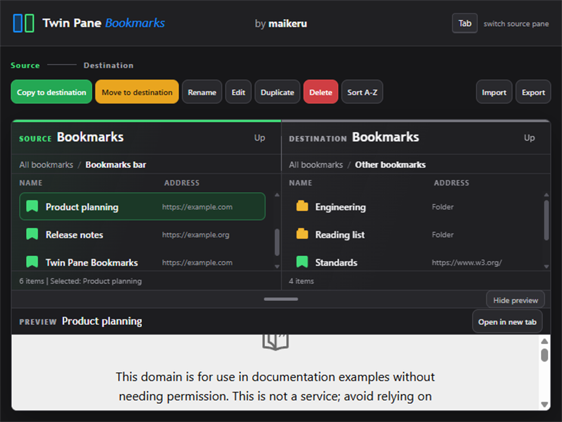

# Twin Pane Bookmarks

A Chrome Manifest V3 extension for managing bookmarks with independent source and destination panes.

## Install in Chrome

1. Open `chrome://extensions`.
2. Turn on **Developer mode**.
3. Choose **Load unpacked** and select this project folder.
4. Click the extension button to open the manager in a browser tab.

## Use

- Click a pane to make it active. `Tab` also switches the active pane.
- The active pane is the source; the other pane is the destination.
- Click a row to select it. Double-click a folder to navigate into it; double-click a bookmark to open it.
- Use **Copy to destination** or **Move to destination** for the selected source item. Folder copies include their contents.
- **Sort A-Z** puts folders before bookmarks and alphabetizes each group in the current folder, updating Chrome's saved bookmark order.
- **Import** opens the browser file picker for a Netscape-format bookmarks HTML file and imports it into the active folder. **Export** downloads the full bookmark tree in the same format.
- **Rename**, **Edit**, **Delete**, and **Duplicate** operate on the selected source item.
- Use each pane's breadcrumbs or **Up** button to navigate independently.
- Select a bookmark to preview it in the lower pane. Drag the divider to resize it, or use its arrow keys; **Hide preview** collapses it.
- Previews embed HTTP and HTTPS pages. Some websites block embedding; use **Open in new tab** in that case.
- Keyboard shortcuts: `Ctrl+A` selects all visible items in the active pane; `Ctrl+C` copies selected bookmarks to the extension clipboard; `Ctrl+X` stages them for cutting without changing the source; `Ctrl+V` pastes to the other pane. `Space` selects/deselects the focused item; `Up`/`Down` moves to the previous/next item; `Shift+Up`/`Shift+Down` extends the selection range; `Home`/`End` selects the first/last item; `Delete` removes selected items after confirmation. Copy/Move/Duplicate also apply to all selected items, while Rename/Edit require one item. `Backspace` goes to the parent folder. `Enter` opens a selected folder or shows a bookmark preview; `Ctrl+1` copies, `Ctrl+2` moves, `Ctrl+3` renames, and `Alt+Enter` edits the selected bookmark.

The extension requests only the `bookmarks` permission and does not send bookmark data anywhere.